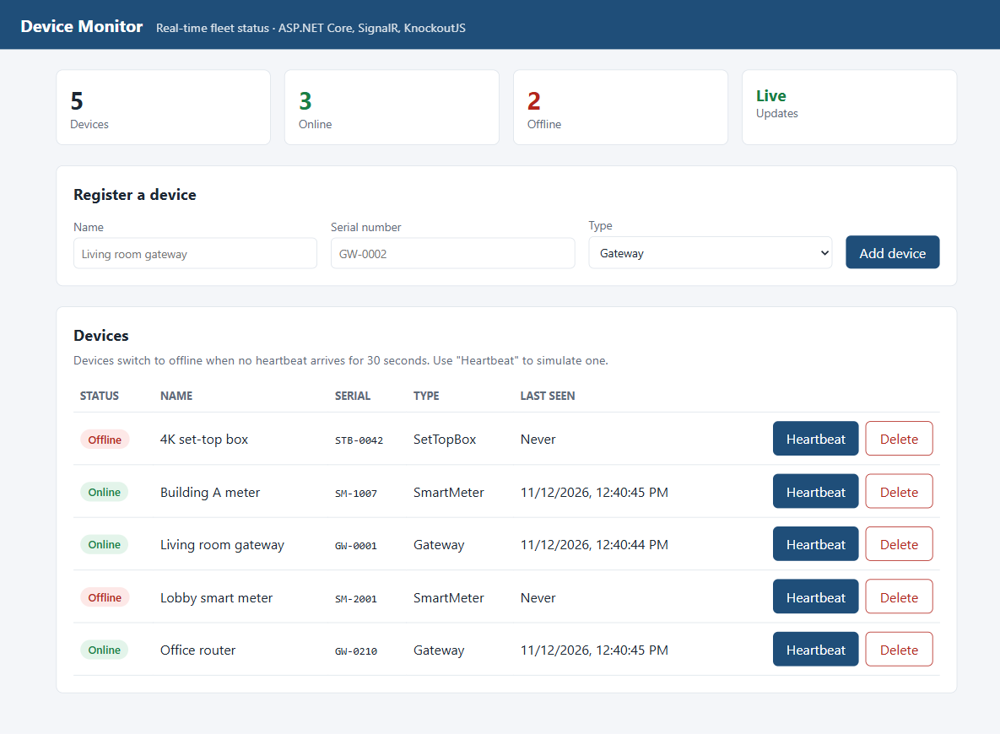
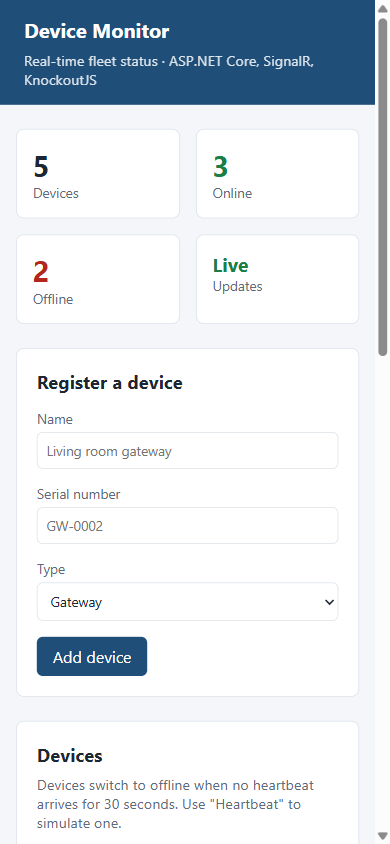

# Device Monitor

[](https://github.com/Ghaithmeftah/device-monitor/actions/workflows/ci.yml)

A small dashboard that shows which devices of a fleet are online, and updates live when that changes.



## Why I'm building this

At work I build web platforms with ASP.NET Core, Angular and Symfony, but a few tools I wanted to get better at never
came up in my projects: SignalR, KnockoutJS and a proper test setup for .NET. So I picked a problem where all of them
make sense, keeping track of connected devices (internet boxes, set-top boxes, smart meters) that send a heartbeat
and go offline when they stop, and I'm building it on my own time.

It's a learning project, not a product. I keep it small on purpose so every part is something I wrote, understand
and can explain.

## What it does

- Register devices through a REST API (name, serial number, type). Serial numbers are unique, enforced by a database index.
- A device calls `POST /api/devices/{id}/heartbeat` to say it's alive. The dashboard has a button to simulate it.
- Every open dashboard gets the change right away through SignalR, without refreshing.
- A background job checks every 5 seconds and switches a device to offline after 30 seconds without a heartbeat.
- The page works on a phone too.



## How it's put together

```
Browser (KnockoutJS view models)
   |  fetch /api/devices              ^  SignalR: DeviceUpdated, DeviceDeleted
   v                                  |
DevicesController -> DeviceService -> AppDbContext (EF Core) -> PostgreSQL
                          |
                          +-> IDeviceNotifier -> DeviceHub (SignalR)

OfflineDetector (BackgroundService) -> DeviceService.MarkStaleDevicesOfflineAsync
```

A few choices I made and why:

- **Controllers stay thin.** They only translate HTTP. The rules (normalizing serials, refusing duplicates, the offline
  timeout) live in `DeviceService`.
- **SignalR is behind an interface.** `DeviceService` talks to `IDeviceNotifier`, not to the hub, so I can unit-test it
  with a fake that records what would have been sent.
- **Time is injected.** The service uses `TimeProvider` instead of `DateTime.UtcNow`, so the test for "offline after
  30 seconds" moves a fake clock forward instead of waiting.
- **The front end is MVVM with KnockoutJS.** Each device row is a view model with observables. Updates from the API
  and from SignalR go through the same `upsert`, so receiving the same change twice is harmless.

## Tests

14 xUnit tests, no database server needed (they use SQLite in memory):

- Unit tests on `DeviceService`: duplicate serials, heartbeats, the offline timeout, deletes.
- Functional tests that start the whole app in memory with `WebApplicationFactory` and call the real API: validation
  errors (400), duplicates (409), unknown devices (404), and one test that connects a real SignalR client and checks
  that a heartbeat is pushed to it.

```bash
dotnet test
```

GitHub Actions runs the build, the tests and the Docker build on every push.

## Run it

You need Docker:

```bash
docker compose up --build
```

Then open http://localhost:8080. It starts PostgreSQL, applies the EF Core migrations and adds three demo devices.
If port 8080 is taken, set `WEB_PORT`, for example `WEB_PORT=8095 docker compose up --build`.

To run without Docker you need the .NET 10 SDK and a PostgreSQL database matching the connection string in
`src/DeviceMonitor.Web/appsettings.json`:

```bash
dotnet run --project src/DeviceMonitor.Web
```

Try the API from a terminal while the dashboard is open, and watch the row change:

```bash
curl -X POST http://localhost:8080/api/devices/1/heartbeat
```

## API

| Method | Route | Returns |
|---|---|---|
| GET | `/api/devices` | All devices |
| GET | `/api/devices/{id}` | One device, or 404 |
| POST | `/api/devices` | 201, or 400 if invalid, or 409 if the serial number exists |
| DELETE | `/api/devices/{id}` | 204, or 404 |
| POST | `/api/devices/{id}/heartbeat` | The device, now online, or 404 |

## Stack

C# and .NET 10, ASP.NET Core (MVC and Web API), Entity Framework Core with PostgreSQL, SignalR, KnockoutJS, xUnit,
Docker, GitHub Actions.

## Next

Things I want to add as I keep learning:

- Authentication, so only registered devices can send heartbeats (an API key per device)
- A history of status changes per device, with a small chart
- An Oracle version of the data layer, to compare it with PostgreSQL
- Integration tests against a real PostgreSQL with Testcontainers

## Author

Ghaith Mefteh, software engineer in Tunisia.
[Portfolio](https://ghaithmeftah.github.io/) · [LinkedIn](https://www.linkedin.com/in/ghaith-mefteh-995a18157)
